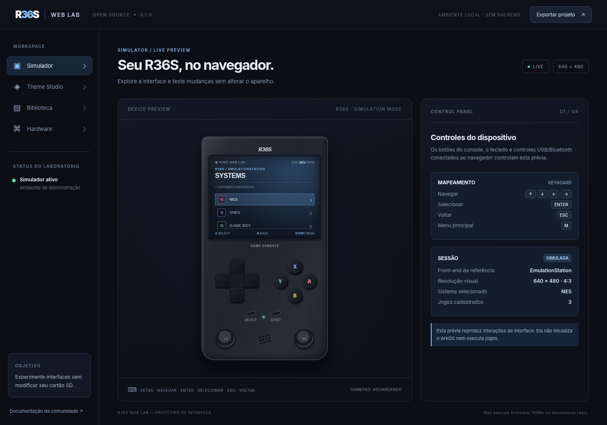

# R36S Web Lab

Laboratório web de interface, visualização do R36S e inspeção local de imagens de firmware. O projeto é independente da comunidade ArkOS, EmulationStation e Sketchfab.

> **Importante:** o projeto não inicializa o firmware real do R36S e não é um emulador do SoC Rockchip RK3326. O ROM Player usa núcleos de terceiros no navegador para jogos compatíveis, não executa o sistema operacional ArkOS.



## Ferramentas

- **Modelo 3D:** incorporação oficial do [R36S console de Moh1993 no Sketchfab](https://sketchfab.com/3d-models/r36s-console-c6ecbfabf473479a8ffd73149090c5bb), com câmera interativa e atribuição permanente.
- **Simulador:** menus 2D, botões, teclado e Gamepad API. A tela 2D não está conectada à superfície do modelo do Sketchfab.
- **Firmware Lab:** importa localmente arquivos .img, .iso, .img.xz, .img.gz, .zip e .dtb. Lê os primeiros 34 KiB e identifica assinaturas MBR, ISO 9660, FDT e partições MBR quando disponíveis. Não descomprime nem executa firmware.
- **ROM Player (beta):** interface separada para arquivos próprios de NES, SNES, Game Boy, Game Boy Advance e PlayStation 1, por meio de [EmulatorJS](https://emulatorjs.org/). ROMs, ISOs de jogo e BIOS não são distribuídas. Compatibilidade experimental; ainda depende de verificação prática com arquivos reais e ambiente de navegador.
- **Theme Studio:** prévia 2D de paleta, fundo, fonte e linhas LCD, com exportação de XML experimental do EmulationStation.
- **Biblioteca:** importação local e limitada de gamelist.xml, sem execução dos arquivos listados.
- **Hardware:** especificações de referência; clones, revisões de placa e painéis diferem.

## Arquivos .img e .iso: diferença

O ArkOS usado no R36S é geralmente distribuído como **imagem de cartão microSD**, muitas vezes no formato .img.xz. O firmware depende de bootloader, device tree, kernel, GPU, periféricos e componentes específicos do RK3326. Abrir ou reconhecer suas partições **não equivale a dar boot**.

Uma .iso normalmente descreve um disco óptico. O ROM Player pode tentar abrir algumas imagens de **disco de jogo PlayStation 1** como .iso, mas isso **não inicializa ArkOS**. Imagens de cartão ArkOS são inspecionadas somente no Firmware Lab. Arquivos CUE/BIN com múltiplos arquivos não são suportados pelo carregamento atual.

Para emular o sistema completo será preciso um backend/simulador de hardware próprio, com testes específicos dos periféricos e do kernel. Um QEMU genérico não garante que a imagem original do R36S inicialize.

## Execução local

Hospede a pasta usando HTTP:

```bash
python3 -m http.server 4173
```

Abra http://localhost:4173. O site também é publicado via GitHub Pages após a habilitação do Pages na configuração do repositório.

Para executar os testes unitários, com Node.js 22 ou superior:

```bash
npm test
```


## Dados, privacidade e terceiros

- O Firmware Lab lê apenas o início do arquivo com File.slice; não transfere imagens para um servidor e não altera SD.
- O simulador e o editor guardam apenas preferências visuais no armazenamento local. O parser de gamelist.xml rejeita DOCTYPE/ENTITY e impõe limites de tamanho e de itens.
- A aba 3D carrega conteúdo externo diretamente dos servidores Sketchfab (inclusive sua política de privacidade, cookies e coleta técnica).
- O ROM Player solicita a biblioteca de emulação ao CDN do EmulatorJS após a escolha de iniciar. O código do Web Lab usa object URLs para arquivos locais; bibliotecas externas podem ter comportamentos e políticas próprios. Não forneça arquivos sensíveis ou não autorizados.
- Nenhum arquivo de firmware, ROM, BIOS, modelo 3D ou textura de terceiros está incorporado ao repositório.
- Utilize apenas dumps e arquivos que você tenha direito de executar. Faça backup antes de modificar um R36S físico.

## Estrutura

```text
index.html                interface principal
styles.css                estilos e responsividade
rom-player.html           ambiente de execução de ROM separado
rom-player.css            estilos do ambiente ROM Player
src/app.js                navegação e simulação 2D
src/model.js              modelo de dados e exportação XML
src/firmware.js           inspeção de cabeçalho de imagem em leitura
src/firmware-ui.js        interface para inspeção de imagens
src/rom-player.js         inicialização do EmulatorJS sob demanda
tests/                    testes unitários
.github/workflows/        integração contínua e Pages
```


## Publicação

No repositório GitHub, abra Settings → Pages e selecione **GitHub Actions** em Build and deployment → Source. Depois execute o workflow em Actions. Sem essa configuração, actions/configure-pages pode falhar com HTTP 404 antes de publicar qualquer arquivo.

## Créditos e licenças

- Modelo incorporado: [R36S console](https://sketchfab.com/3d-models/r36s-console-c6ecbfabf473479a8ffd73149090c5bb) por [Moh1993](https://sketchfab.com/Moh1993), hospedado no Sketchfab. O arquivo 3D **não** faz parte desta distribuição. Direitos do autor preservados.
- Emulação opcional: [EmulatorJS](https://github.com/EmulatorJS/EmulatorJS), software independente disponibilizado por CDN, sob as respectivas licenças e termos.
- ArkOS: [AeolusUX/ArkOS-R3XS](https://github.com/AeolusUX/ArkOS-R3XS) e [ArkOS Wiki](https://github.com/christianhaitian/arkos/wiki).
- Interface de temas: [EmulationStation THEMES.md](https://github.com/Aloshi/EmulationStation/blob/master/THEMES.md).

O código original do R36S Web Lab é MIT (LICENSE). A licença MIT deste repositório não abrange modelos externos, componentes do Sketchfab, núcleos de emulação, ArkOS, ROMs ou BIOS.
